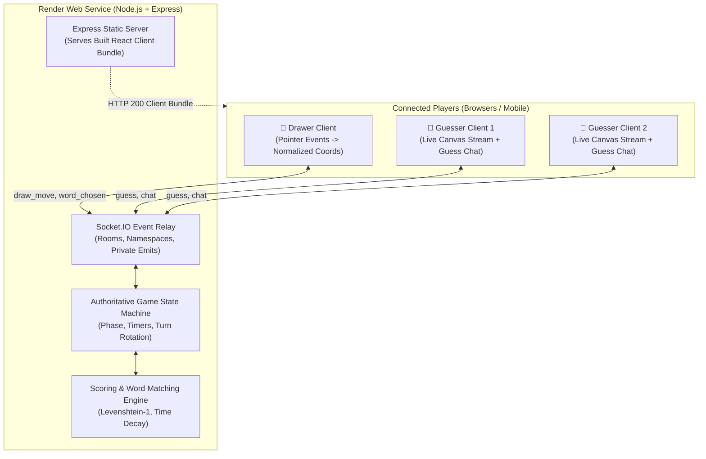
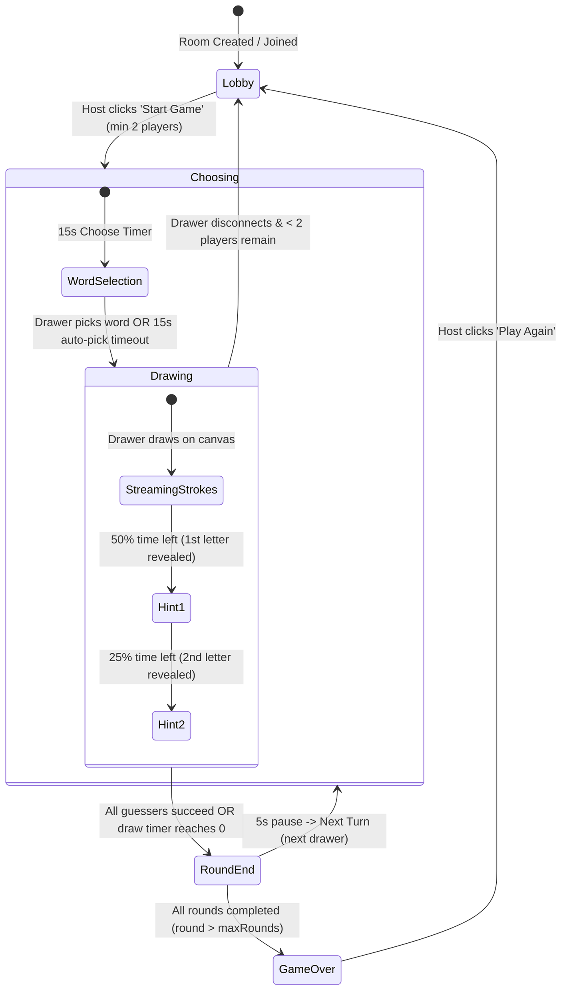
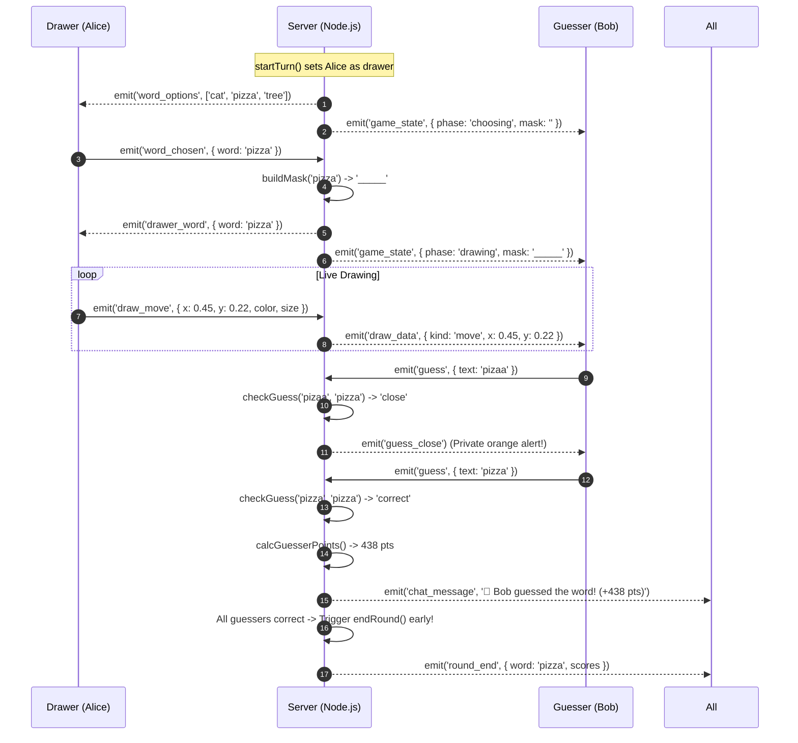
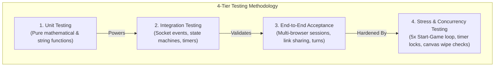
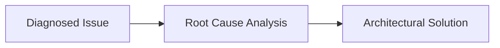

# Skribbl — Real-Time Multiplayer Drawing & Guessing Game

> An end-to-end multiplayer Pictionary clone built with React, Node.js, Express, Socket.IO, and HTML5 Canvas.

**🌐 Live Application:** [https://skribbl-clone-assignment.onrender.com/](https://skribbl-clone-assignment.onrender.com/)  
*Note: The backend runs on Render's free tier that sleeps when idle, so the first request after an inactive period can take about 45–60 seconds to wake. After that, WebSockets and the game loop run in real time with zero latency.*

**📂 GitHub Repository:** [https://github.com/Shivansh-20/skribbl-clone-assignment](https://github.com/Shivansh-20/skribbl-clone-assignment)

---

### 📐 Documentation Philosophy
This README intentionally follows a visual-first technical specification structure:
* **60% Architecture & Flow Diagrams**: Prioritizing state machines, sequence lifecycles, and visual data pipelines over walls of text.
* **20% Conceptual Deep-Dives**: Concrete engineering explanations for the five core technical questions required by the assignment brief.
* **20% Operational Overview**: Clear, step-by-step instructions for local reproduction and verification.

---

## 🏗️ 1. Architecture & System Flow (Visual-First)

### High-Level System Architecture


---

### Game State Machine & Phase Transitions


---

### Real-Time Drawing & Guessing Sequence


---

## 🧠 2. Core Technical Concepts (The 5 Key Questions)

The assignment specification identifies five core areas required for technical evaluation:

### 1. How drawing strokes are captured, sent, and rendered across clients
* **Capture (`Canvas.jsx`)**: The drawer interacts with an HTML5 `<canvas>` using the Pointer Events API (`onPointerDown`, `onPointerMove`, `onPointerUp`). Pointer capture (`setPointerCapture`) prevents broken lines when moving fast across borders.
* **Coordinate Normalization (`canvas.js`)**: Screens vary in size (e.g. desktop vs mobile). Sending raw pixel offsets (like $x=450, y=300$) breaks on smaller screens. Coordinates are converted to **fractions between 0.0 and 1.0**:
  $$\text{fraction}_x = \frac{\text{clientX} - \text{canvas.left}}{\text{canvas.width}}, \quad \text{fraction}_y = \frac{\text{clientY} - \text{canvas.top}}{\text{canvas.height}}$$
* **Transmission**: Packets are emitted over WebSockets via `draw_start` and `draw_move` containing `(x, y)` fractions, stroke color, and brush size.
* **Rendering**: Receiving browsers multiply the incoming fractions by their local canvas dimensions:
  $$\text{local}_x = \text{fraction}_x \times \text{localWidth}, \quad \text{local}_y = \text{fraction}_y \times \text{localHeight}$$
  The canvas context draws smooth lines using `ctx.lineCap = 'round'` and `ctx.lineJoin = 'round'`.

---

### 2. How game state (rounds, turn order, scoring) is managed
* **Authoritative Server (`server/src/game.js`)**: All game state runs strictly on the Node.js server to prevent client-side score tampering:
  ```javascript
  room = { phase, round, drawerIndex, word, mask, timeLeft, guessedCount, players, strokes }
  ```
* **Turn & Round Rotation (`nextTurn`)**: A "Turn" is one player drawing. A "Round" completes only after every connected player has drawn once:
  $$\text{nextDrawerIndex} = (\text{drawerIndex} + 1) \pmod{\text{totalPlayers}}$$
  When the index cycles back to 0, `round` increments. When `round > maxRounds`, the game triggers the final podium leaderboard.
* **Scoring Logic (`server/src/scoring.js`)**:
  * **Guesser Points**: Decays with speed (up to 400 pts) + base (50 pts) + first-guesser trophy bonus (50 pts):
    $$\text{Points}_{\text{guesser}} = \text{round}\left(400 \times \frac{\text{timeLeft}}{\text{drawTime}}\right) + 50 + (\text{order} == 1 \, ? \, 50 : 0)$$
  * **Drawer Points**: Awards points based on how many players successfully solved their sketch:
    $$\text{Points}_{\text{drawer}} = \text{round}\left(300 \times \frac{\text{correctCount}}{\text{totalGuessers}}\right)$$

---

### 3. How WebSockets are used for real-time sync
* **Socket.IO Rooms**: Each room has an isolated 5-character room code (e.g., `X7K9P`). All players in that game join `socket.join(roomCode)`.
* **Private vs. Broadcast Channels**:
  * **Broadcast (`io.to(code).emit`)**: Public events like `draw_data`, public chat messages, and sanitized state snapshots (`mask: "____"`).
  * **Private Directed (`io.to(socket.id).emit`)**: Secret data like 3-word selection options (`word_options`), the drawer's chosen word (`drawer_word`), and "You are close!" typo warnings (`guess_close`).
* **Heartbeat Ping-Pong**: Continuous WebSocket ping-pong monitors network connectivity; if a drawer disconnects mid-turn, the server detects it and ends the round immediately.

---

### 4. Word-matching logic (Case, Trim, Partial / Levenshtein-1)
* **Normalization (`normalize`)**: Text input is converted to lowercase and stripped of leading/trailing whitespace (`text.trim().toLowerCase()`).
* **Levenshtein-1 Typo Tolerance (`isClose`)**: Evaluates whether two words are within **1 edit distance** (1 substituted letter, 1 missing letter, or 1 extra letter).
  * `apple` vs `apple` $\to$ `'correct'`
  * `aple` vs `apple` (1 missing) $\to$ `'close'`
  * `applee` vs `apple` (1 extra) $\to$ `'close'`
  * `appla` vs `apple` (1 replaced) $\to$ `'close'`
* **Privacy Guard**: When a guess is `'close'`, the server sends an alert **only** to the sender, keeping the guess private so opponents cannot copy it.

---

### 5. Deployment setup and platform constraints (Vercel vs. Render)
* **The Serverless Constraint (Vercel / Netlify)**:  
  Serverless platforms spin up ephemeral execution environments that terminate after an HTTP request finishes. They **cannot maintain persistent, stateful TCP WebSocket connections**. Hosting Socket.IO on Vercel causes failed handshakes or immediate disconnections.
* **The Full-Stack Container Solution (Render)**:  
  Render provides a long-running Node.js process with native WebSocket support. We configured our Express backend to serve the compiled Vite frontend bundle statically from `client/dist` while handling Socket.IO on the **exact same port and domain**:
  - One single live URL.
  - Zero cross-origin (CORS) friction.
  - Persistent 24/7 bidirectional WebSocket connections.

---

## 🧪 3. Testing Methodology & Verification (Visual + Matrix)

### Testing Taxonomy Hierarchy


### Automated Verification Matrix (`npm test`)

Execute the built-in automated test suite:
```bash
npm test
```

| Suite | Category | Scope / Tested Scenario | Result |
|---|---|---|:---:|
| **Suite 1** | Unit | String trimming, lowercase normalization, safety fallbacks | ✅ PASS |
| **Suite 2** | Unit | Levenshtein-1 typo distance (`correct` vs `close` vs `wrong`) | ✅ PASS |
| **Suite 3** | Unit | Guesser points formula (Speed decay + 1st place trophy bonus) | ✅ PASS |
| **Suite 4** | Unit | Drawer points formula (Fractional reward on guesser success rate) | ✅ PASS |
| **Suite 5** | Unit | Regex word masking (`buildMask`) & dynamic hint revealer (`revealHint`) | ✅ PASS |
| **Suite 6** | Integration | Drawer guess blocking (Drawer cannot guess own canvas) | ✅ PASS |
| **Suite 7** | Integration | Private event routing (`guess_close` sent only to sender) | ✅ PASS |
| **Suite 8** | Integration | Early round termination when all non-drawers guess correctly | ✅ PASS |
| **Suite 9** | Integration | Room settings bounds clamping (`sanitizeSettings`) & 5-char code generator | ✅ PASS |
| **Suite 10** | Integration | Drawer rotation & max round advance state machine (`nextTurn`) | ✅ PASS |
| **Suite 11** | Stress | **5x Automated Start-Game Cycle** (Create $\to$ Join $\to$ Start on 1st click) | ✅ PASS (5/5 in ~160ms) |
| **Suite 12** | Production | Vite production bundle compilation (`npm run build`) | ✅ PASS (1.32s) |

---

## 🛠️ 4. Engineering Challenges & Production Bug Post-Mortems



| # | Bug Encountered | Root Cause | Solution Implemented |
|---|---|---|---|
| **1** | **Invisible Cursor / White Canvas Trap** | Pure white swatch `#ffffff` drew invisibly on white canvas; browser crosshair cursor inverted against white pixels. | Replaced swatch with Pink (`#ff6b81`), reserved white strictly for `🧹 Eraser`, and built a custom 2-tone SVG crosshair (black outer ring, white inner ring). |
| **2** | **Canvas Wipe on Flex Layout Shift** | HTML5 Canvas resets its bitmap whenever `canvas.width` is reassigned by `ResizeObserver`. | Guarded `resizeCanvas()` to only reassign width if pixel dimensions actually changed, and created an authoritative `strokeHistory` ref buffer to replay strokes. |
| **3** | **Missing Figures (`lineWidth: NaN`)** | `draw_move` socket events omitted color and size, setting `ctx.lineWidth = NaN` on remote clients. | Forwarded color and size in all move packets, and added defensive fallback defaults (`color \|\| '#000000'`, `size \|\| 8`). |
| **4** | **Canvas Not Clearing on Turn Rotation** | Server reset `room.strokes = []` in memory, but omitted emitting `canvas_clear` to browsers. | Added `io.to(room.code).emit('canvas_clear')` on `startTurn()` and reset `syncedStrokes` on client. |
| **5** | **Stale Game Over Modal on Disconnect** | `App.jsx` handled `choosing` and `drawing` transitions, but had no branch for `phase === 'lobby'`. | Added `else if (snapshot.phase === 'lobby')` in `App.jsx` to return to lobby and dismiss stale modals. |
| **6** | **Close-Guess Timer Race Condition** | Consecutive typos arriving within 2 seconds had their banners abruptly hidden by the earlier guess's `setTimeout`. | Stored a `closeTimerRef` to reset timeouts, and appended persistent private orange callouts directly into the chat stream. |
| **7** | **Mobile Portrait Flexbox Collapse** | In portrait mode (360px), desktop 3-column flex compressed the canvas to 0px width; word mask wrapped into an 11-row vertical ladder. | Added `@media (max-width: 850px)` responsive stylesheet: Canvas stacks on top (300px), Chat sits directly below, and `white-space: nowrap;` locks mask dashes horizontally. |
| **8** | **Drawer Secret Word Invisibility on Auto-Pick** | `getPublicSnapshot` scrubbed `word: null` for security, overwriting the drawer's state with null on auto-pick or hints. | Built `emitGameState(io, room)` multi-caster: guessers get the masked string, while the active drawer receives their secret word in green (`WORD: CAT`). |
| **9** | **Initial Start Game Click Dropped** | Browsers natively drop mouse clicks on HTML buttons with `disabled={true}` while Player 2 is connecting. | Added bidirectional `ack` callback to `start_game` to validate room state immediately; verified with 5x stress test. |

---

## 🚀 5. Quick Start (Run Locally)

```bash
# 1. Clone repository
git clone https://github.com/Shivansh-20/skribbl-clone-assignment.git
cd skribbl-clone-assignment

# 2. Run automated test suite
npm test

# 3. Start backend server (Port 3001)
npm run dev:server

# 4. In a second terminal, start frontend client (Port 5173)
npm run dev:client
```
Open `http://localhost:5173` in two browser windows side by side to test multiplayer gameplay.

---

## 🔮 6. Future Roadmap (Nice-To-Have Architectural Extensions)

Architectural concepts designed for future iterations:
* **Host Kick & Votekick Moderation**: Consensus voting ($> 50\%$ room agreement) to evict disruptive players.
* **Custom Word Banks**: Host can upload custom comma-separated word lists for specialized trivia nights.
* **Spectator Mode**: Allow players to join full rooms as read-only viewers with real-time canvas streaming.
* **Canvas Stroke Replay**: An animated replay mode that reproduces the winning drawer's stroke sequence step-by-step.
